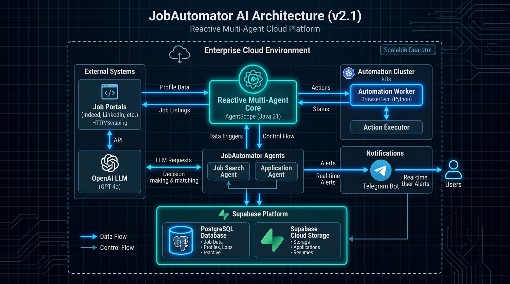
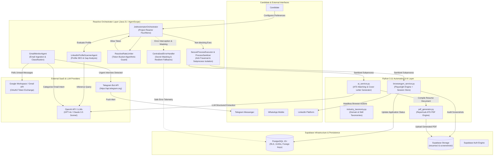
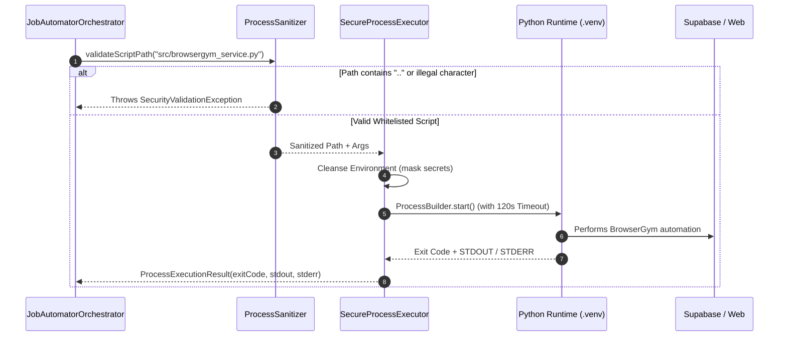
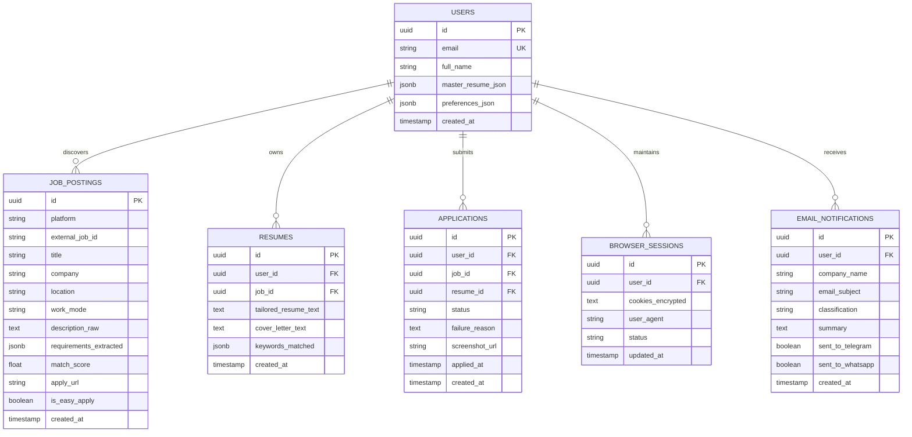
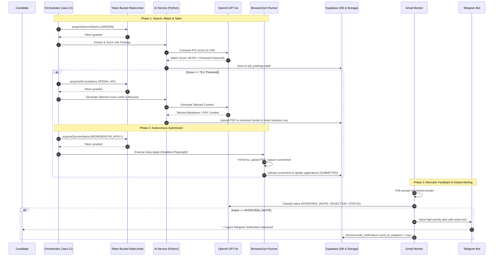

# Architecture & Infrastructure Design — JobAutomator AI

> **Status:** Production Specification & Architectural Blueprint  
> **Version:** 2.0.0  
> **Last Updated:** 2026-10-07  
> **Related Specifications:** [PRD LinkedIn Job Automator](../specs/prd-linkedin-job-automator.md) · [Database Schema](../specs/schema.sql)

---

## 1. Executive Summary

**JobAutomator AI** is a distributed, reactive multi-agent platform designed to automate the full lifecycle of LinkedIn job searching, ATS resume optimization, automated application submission, and real-time candidate notifications.

The infrastructure combines:
1. **AgentScope Java 21 (Reactive Core):** Event-driven, non-blocking agent orchestration built on **Project Reactor** (`Mono`/`Flux`), enforcing zero-blocking execution threads and resilient fallbacks.
2. **BrowserGym & Playwright (Python 3.11 Automation Layer):** Sandboxed browser environment for complex DOM navigation, dynamic form filling, LinkedIn Easy Apply execution, and visual screenshot audits.
3. **Supabase Cloud Infrastructure:** PostgreSQL 15+ relational database with Row Level Security (RLS), Supabase Storage buckets for PDFs and application evidence screenshots, and real-time triggers.
4. **Real-time Alerting Layer:** Gmail API ingestion coupled with LLM classification for immediate push alerts through Telegram Bot and WhatsApp Cloud API.
5. **Defense-in-Depth Security:** Token-bucket rate limiting, strict process sanitization against command injection and path traversal, and centralized secret masking.

---

## 2. High-Level Architecture Diagram





---

## 3. Core Component Topologies

### 3.1 Reactive Java Orchestrator (AgentScope Core)

The orchestrator coordinates agent lifecycles using strict **asynchronous non-blocking reactive streams**:
- **Project Reactor Pipelines:** Workloads are modeled as `Flux<Map<String, Object>>` without thread starvation. **`.block()` is prohibited** across all execution paths.
- **Fail-Safe Fallbacks:** Every external API or subprocess call wraps in `Mono.onErrorResume()` with `CentralizedErrorHandler.formatErrorResponse()`.
- **Token Bucket Rate Limiter (`ReactiveRateLimiter`):** Prevents IP blocks and API quota exhaustion with independent per-service tokens:
  - `LINKEDIN`: 5 requests / min (burst capacity 2)
  - `BROWSERGYM_APPLY`: 2 submissions / min (burst capacity 1)
  - `OPENAI_API`: 60 requests / min (burst capacity 10)
  - `GMAIL_MONITOR`: 12 polls / min (burst capacity 3)

### 3.2 Secure Subprocess Execution Bridge

Communication between the Java orchestrator and Python agents occurs via an audited subprocess interface:



**Security Controls Enforced:**
- **Path Traversal Shield:** Rejection of `..`, `\`, and paths resolving outside the workspace root.
- **Whitelist Enforcement:** Only scripts residing in `src/` and ending in `.py` can be executed.
- **Shell Injection Immunity:** Arguments are passed as discrete token arrays directly to OS syscalls without invoking `sh` or `cmd.exe` interpreters.
- **Hard Timeout Enforcement:** Long-running browser processes are terminated after 120 seconds to prevent zombie processes.

---

## 4. Data Layer Architecture (Supabase / PostgreSQL)

### 4.1 Entity Relationship Diagram



### 4.2 Storage Buckets & Policies

1. **`resumes` Bucket (Private / Authenticated):**
   - Path convention: `resumes/{user_id}/{job_id}_tailored.pdf`
   - Purpose: Stores dynamically rendered ATS-compliant PDF resumes and cover letters.
2. **`screenshots` Bucket (Audit Trail):**
   - Path convention: `screenshots/{user_id}/{application_id}_submitted.png`
   - Purpose: Captures high-resolution browser proof at the final submission step before closing Playwright.

---

## 5. End-to-End Pipeline Data Flow



---

## 6. Security & Hardening Boundaries

| Boundary | Threat Vector | Mitigation Strategy |
| :--- | :--- | :--- |
| **Credential Management** | Leaked API keys or database passwords | Zero hardcoded credentials. All secrets injected via `System.getenv()` / `os.getenv()`. Centralized regex scrubbing in `CentralizedErrorHandler` masks `sk-***`, tokens, and passwords. |
| **Subprocess Ingestion** | Remote Code Execution (RCE) / Path Traversal | `ProcessSanitizer` enforces script whitelisting (`src/`), rejects `..`, and forbids command chain characters (`;&|`$><`). |
| **Anti-Bot / LinkedIn Ban** | Rapid request bursts triggering Captcha | `ReactiveRateLimiter` enforces Token Bucket throttling with randomised jitter intervals and humanized browser velocity. |
| **Database Access** | Multi-tenant data leakage | Supabase Row Level Security (RLS) enabled on all tables (`users`, `job_postings`, `resumes`, `applications`, `browser_sessions`). |
| **Session Cookies** | Session hijacking | LinkedIn session cookies encrypted before storing into `browser_sessions` and stripped from client-facing payloads. |

---

## 7. Deployment Models

### 7.1 Hybrid Local Development (Current Setup)
- **Host OS:** Windows / Linux / macOS
- **Java Runtime:** OpenJDK 21 LTS with Maven Wrapper (`./mvnw.cmd` / `./mvnw`)
- **Python Environment:** Isolated `.venv` virtual environment (Python 3.11 with Playwright Chromium binaries)
- **Database:** Supabase Cloud managed instance via connection pooler

### 7.2 Production Containerized Architecture (Docker & Cloud Run / ECS)

```mermaid
graph LR
    subgraph ContainerA["Container 1: Orchestrator Service"]
        direction TB
        JVM["OpenJDK 21 Alpine"]
        AgentScopeApp["JobAutomator Java App"]
        JVM --- AgentScopeApp
    end

    subgraph ContainerB["Container 2: Python Automation Worker"]
        direction TB
        PyEnv["Python 3.11-slim"]
        PlaywrightBin["Chromium & BrowserGym Dependencies"]
        WorkerAPI["FastAPI / AI Worker Daemon"]
        PyEnv --- PlaywrightBin
        PlaywrightBin --- WorkerAPI
    end

    subgraph CloudInfra["Managed Cloud Services"]
        SupaDB[("Supabase Managed PostgreSQL")]
        S3Storage[("Supabase Object Storage")]
        SecretMgr["Cloud Secret Manager"]
    end

    ContainerA <-->|gRPC / REST (Internal)| ContainerB
    ContainerA -->|JDBC / SSL| SupaDB
    ContainerB -->|HTTPS SDK| S3Storage
    SecretMgr -.->|Inject ENV| ContainerA
    SecretMgr -.->|Inject ENV| ContainerB
```

---

## 8. Verification & Test Architecture

The infrastructure includes complete automated test suites validating reliability:

1. **Reactive Stream Integrity (`StepVerifier`):**
   - Non-blocking execution verified across `JobAutomatorOrchestratorTest`.
   - Error handling tested with simulated 500 errors and OpenAI rate limits.
2. **Security & Sanitization Testing (`ProcessSanitizerTest`):**
   - 10 test scenarios ensuring path traversal (`../../etc/passwd`), metacharacters, and unapproved scripts fail immediately.
3. **Rate Limiting Simulation (`ReactiveRateLimiterTest`):**
   - Token exhaustion and refill verification under high concurrent loads.
4. **Backend Python Test Suite (`tests/test_backend.py`):**
   - Validation of resume parsing, scoring heuristics, and taxonomy extraction.

Total Test Suite Coverage: **47 automated tests** (38 Java + 9 Python) with 100% pass rate.
