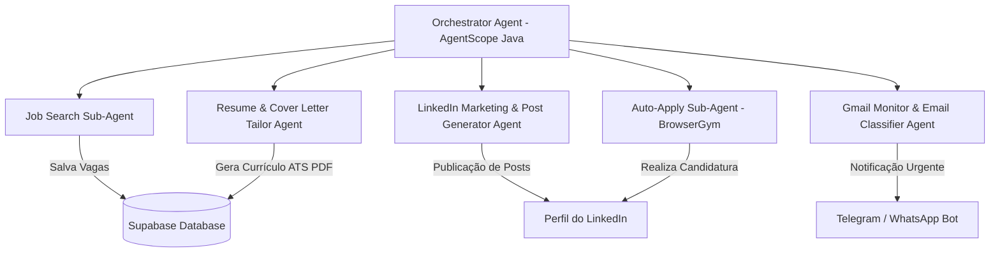

# PRD - Automação Inteligente de Vagas, Notificações e Marketing LinkedIn (JobAutomator AI)

> **Versão**: 1.1.0  
> **Status**: Especificação Atualizada com Áudio do Usuário (Spec-Driven Development)  
> **Arquitetura Base**: AgentScope Java + BrowserGym (Python) + Supabase + Telegram/WhatsApp Notifier + Gmail Monitor  

---

## 1. Visão Geral do Produto

O **JobAutomator AI** é uma plataforma baseada em **Multi-Agentes Reativos** projetada para automatizar o ciclo completo de:
1. Busca, filtragem e candidatura automatizada a vagas no LinkedIn.
2. Monitoramento de respostas por e-mail (Gmail) com **notificação instantânea via Telegram / WhatsApp** (para o candidato não precisar ficar checando e-mails).
3. Geração e agendamento de **posts no LinkedIn** para fortalecer o marketing pessoal e atrair recrutadores organicamente.

---

## 2. Arquitetura de Agentes (Multi-Agent System)

### 2.1 Novos Agentes Especializados

#### 📩 1. Gmail Monitor & Notification Agent (Telegram / WhatsApp)
- **Função**: Monitora a caixa de entrada do Gmail em busca de respostas de processos seletivos e testes de estágio.
- **Filtragem por IA**: Analisa o corpo do e-mail e classifica em:
  - 🟢 **Convite para Entrevista / Teste Técnico** (Prioridade Máxima)
  - 🟡 **Atualização de Status do Processo**
  - 🔴 **Negativa / Agradecimento**
- **Ação**: Quando recebe uma resposta 🟢 ou 🟡, envia imediatamente uma mensagem formatada para o **Telegram** ou **WhatsApp** do candidato com:
  - Nome da Empresa
  - Cargo
  - Resumo do E-mail
  - Próximo passo exigido (ex: link do agendamento ou teste)

#### 🚀 2. LinkedIn Personal Marketing & Post Generator Agent
- **Função**: Gera posts estratégicos para o perfil do LinkedIn do candidato para aumentar o alcance orgânico (*personal branding*).
- **Recursos**:
  - Geração de artigos e posts curtos sobre aprendizados, projetos desenvolvidos, desafios superados e tendências de tecnologia (Java, IA, Python, Cloud).
  - Sugestão de hashtags e call-to-action (CTA).
  - Agendamento de postagens via API do LinkedIn.

---

## 3. Modelo de Dados Atualizado (Supabase)

### Novos campos e tabelas:

#### `email_notifications`
- `id` (uuid, primary key)
- `user_id` (foreign key -> users.id)
- `company_name` (string)
- `email_subject` (string)
- `classification` (string) — "INTERVIEW_INVITE", "STATUS_UPDATE", "REJECTION"
- `summary` (text)
- `sent_to_telegram` (boolean)
- `sent_to_whatsapp` (boolean)
- `created_at` (timestamp)

#### `linkedin_posts`
- `id` (uuid, primary key)
- `user_id` (foreign key -> users.id)
- `topic` (string) — "Java 21", "Multi-Agent Systems", "Project Reactor"
- `post_content` (text)
- `status` (string) — "draft", "scheduled", "published"
- `scheduled_for` (timestamp, nullable)

---

## 4. Requisitos Funcionais Atualizados

### RF-06: Monitoramento Ativo do Gmail
- O sistema deve verificar a caixa de entrada a cada 15 minutos via OAuth2 / Gmail API.
- Usar LLM para identificar e-mails relacionados a vagas ativas.

### RF-07: Notificação em Tempo Real no Telegram / WhatsApp
- Enviar notificação via Bot do Telegram / WhatsApp assim que uma resposta positiva ou agendamento for detectado.

### RF-08: Gerador de Conteúdo para LinkedIn
- Permitir gerar posts semanais sobre o progresso de estudos e projetos no GitHub para atrair recrutadores.
