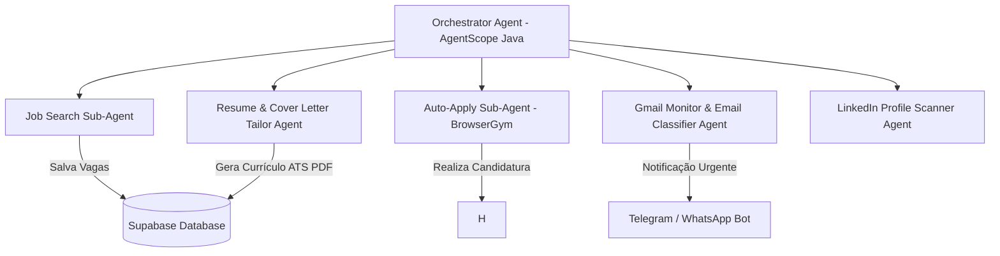

# PRD - Automação Inteligente de Vagas e Notificações (JobAutomator AI)

> **Versão**: 1.1.0  
> **Status**: Especificação Atualizada com Áudio do Usuário (Spec-Driven Development)  
> **Arquitetura Base**: AgentScope Java + BrowserGym (Python) + Supabase + Telegram/WhatsApp Notifier + Gmail Monitor  

---

## 1. Visão Geral do Produto

O **JobAutomator AI** é uma plataforma baseada em **Multi-Agentes Reativos** projetada para automatizar o ciclo completo de:
1. Busca, filtragem e candidatura automatizada a vagas no LinkedIn.
2. Monitoramento de respostas por e-mail (Gmail) com **notificação instantânea via Telegram / WhatsApp** (para o candidato não precisar ficar checando e-mails).

---

## 2. Arquitetura de Agentes (Multi-Agent System)

### 2.1 Novos Agentes Especializados

#### 📩 1. Gmail Monitor & Notification Agent (Telegram / WhatsApp)
- **Função**: Monitora a caixa de entrada do Gmail em busca de respostas de processos seletivos e testes de estágio.
- **Filtragem por IA**: Analisa o corpo do e-mail e classifica em:
  - 🟢 **Convite para Entrevista / Teste Técnico** (Prioridade Máxima)
  - 🟡 **Atualização de Status do Processo**
  - 🔴 **Negativa / Agradecimento**
- **Ação**: Quando recebe uma resposta 🟢 ou 🟡, envia imediatamente uma mensagem formatada para o **Telegram** ou **WhatsApp** do candidato com:
  - Nome da Empresa
  - Cargo
  - Resumo do E-mail
  - Próximo passo exigido (ex: link do agendamento ou teste)

#### 🕵️‍♂️ 2. LinkedIn Profile Scanner Agent
- **Função**: Escaneia o perfil do LinkedIn do candidato e aponta onde estão os erros, seções ausentes e o que precisa ser melhorado.
- **Recursos**:
  - Avaliação de Headline (título).
  - Análise do "Sobre" e experiência.
  - Otimização para palavras-chave (SEO no LinkedIn).
  - Verificação se o estado do perfil impacta o engajamento na plataforma ao criar e usar a conta.

---

## 3. Modelo de Dados Atualizado (Supabase)

### Novos campos e tabelas:

#### `email_notifications`
- `id` (uuid, primary key)
- `user_id` (foreign key -> users.id)
- `company_name` (string)
- `email_subject` (string)
- `classification` (string) — "INTERVIEW_INVITE", "STATUS_UPDATE", "REJECTION"
- `summary` (text)
- `sent_to_telegram` (boolean)
- `sent_to_whatsapp` (boolean)
- `created_at` (timestamp)

---

## 4. Requisitos Funcionais Atualizados

### RF-06: Monitoramento Ativo do Gmail
- O sistema deve verificar a caixa de entrada a cada 15 minutos via OAuth2 / Gmail API.
- Usar LLM para identificar e-mails relacionados a vagas ativas.

### RF-07: Notificação em Tempo Real no Telegram / WhatsApp
- Enviar notificação via Bot do Telegram / WhatsApp assim que uma resposta positiva ou agendamento for detectado.

### RF-08: Test-Driven Development (TDD) & Bateria de Testes Reativa
- Cobertura completa de testes unitários e de integração reativos (JUnit 5, Mockito, Project Reactor `StepVerifier`, Python unittest).
- Verificação de ausência de bloqueios em threads e validação de fallbacks resilientes.

### RF-09: Security Review & Sanitização de ProcessBuilder
- Sanitização estrita de scripts Python executados via sub-processo (`ProcessSanitizer`).
- Prevenção de Path Traversal (`..`), rejeição de metacaracteres de injeção de comando (`;&|`$><`).
- Whitelist de scripts permitidos e higienização de variáveis de ambiente.
- Execução não-bloqueante (`SecureProcessExecutor`) com limite de timeout e encerramento forçado em caso de travamento.

### RF-10: Exception Handling Centralizado & Mascaramento de Credenciais
- Hierarquia centralizada de exceções (`JobAutomatorException`, `SecurityValidationException`, `RateLimitExceededException`).
- Redação automática de segredos (`sk-***`, tokens JWT, senhas) em logs e respostas formatadas (`CentralizedErrorHandler`).
- Fallbacks não-bloqueantes (`onErrorResume`) sem interrupção do pipeline.

### RF-11: Rate Limiting Reativo com Token Bucket
- Controle de vazão e cadência de chamadas (`ReactiveRateLimiter`) via algoritmo Token Bucket não-bloqueante.
- Limites individualizados por serviço: LinkedIn Scraping, BrowserGym Auto-Apply, OpenAI API e Gmail Monitor.

